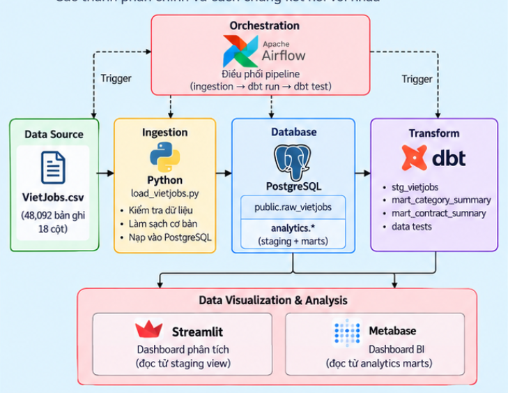
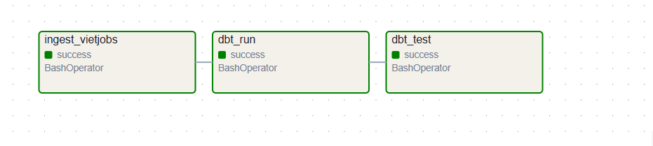
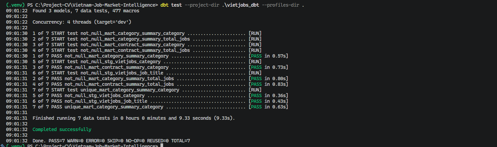
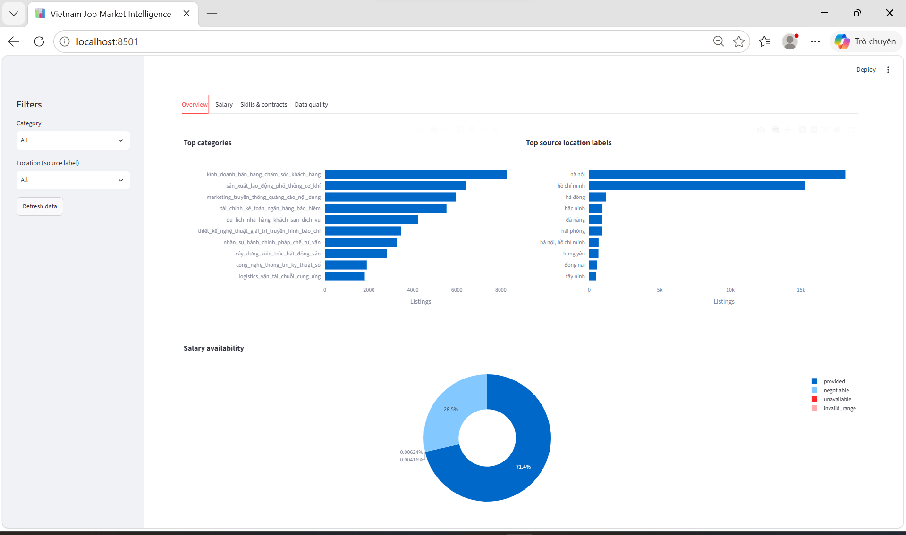
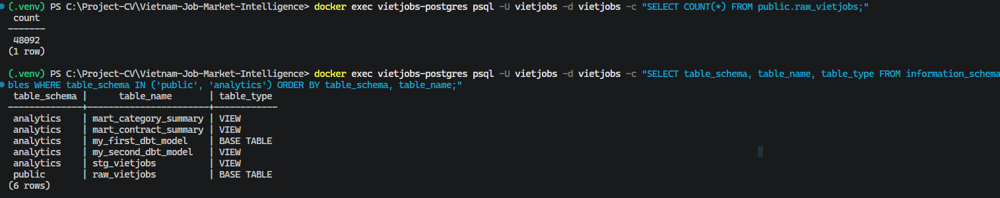

# Vietnam Job Market Intelligence
### Xây dựng Data Pipeline phục vụ phân tích thị trường tuyển dụng Việt Nam

Dự án **Data Engineering end-to-end** sử dụng **Python, PostgreSQL, dbt, Apache Airflow, Docker Compose và Streamlit** để xử lý dữ liệu tuyển dụng từ CSV, tạo các mô hình dữ liệu phân tích và trực quan hóa kết quả. Metabase được triển khai như một công cụ BI bổ sung.

> **Lưu ý:** Dự án sử dụng dữ liệu lịch sử, không thu thập tin tuyển dụng theo thời gian thực. Airflow được kích hoạt thủ công (`schedule=None`).

## 1. Giới thiệu dự án

**Mục tiêu:** xây dựng quy trình có thể chạy lại từ nguồn CSV đến các view phân tích và dashboard, đồng thời thực hành thiết kế pipeline, quản lý cơ sở dữ liệu, chuyển đổi dữ liệu và kiểm thử chất lượng.

Dữ liệu VietJobs đã được khảo sát tại môi trường phát triển:

| Chỉ tiêu | Giá trị |
| --- | ---: |
| Số bản ghi | 48.092 |
| Số cột | 18 |
| Số nhóm ngành | 16 |
| Nguồn dữ liệu | VietJobs CSV |

Các câu hỏi phân tích gồm: phân bố tin tuyển dụng theo ngành và địa điểm; tỷ lệ công khai lương so với lương thỏa thuận; sự khác biệt về khoảng lương; hình thức hợp đồng và các kỹ năng được đề cập.

**Nguồn tham khảo:** [VietJobs (Hugging Face)](https://huggingface.co/datasets/dinhieufam/VietJobs) · [Dự án VietJobs gốc](https://github.com/VinNLP/VietJobs). Tệp CSV không được đưa lên repository; cần kiểm tra quyền sử dụng dữ liệu trước khi phân phối lại.

## 2. Công nghệ sử dụng

| Thành phần | Công nghệ | Chức năng |
| --- | --- | --- |
| Ingestion | Python, psycopg, PostgreSQL COPY | Đọc, kiểm tra và nạp dữ liệu |
| Database | PostgreSQL 16 | Lưu dữ liệu raw và analytical views |
| Transformation | dbt Core, dbt-postgres | Chuẩn hóa, tổng hợp và data tests |
| Orchestration | Apache Airflow | Điều phối các bước pipeline |
| Visualization | Streamlit, pandas, Plotly | Dashboard phân tích |
| BI bổ sung | Metabase | Khai thác dữ liệu từ marts |
| Triển khai local | Docker Compose | Khởi chạy các dịch vụ |

## 3. Kiến trúc hệ thống



Luồng dữ liệu chính:

1. **VietJobs CSV:** nguồn dữ liệu đầu vào.
2. **Python ingestion:** kiểm tra cấu trúc CSV, nạp qua bảng tạm và ghi vào `public.raw_vietjobs` bằng transaction.
3. **PostgreSQL:** lưu bảng raw và các view trong schema `analytics`.
4. **dbt:** tạo staging view, hai mart tổng hợp và chạy data tests.
5. **Streamlit / Metabase:** khai thác kết quả phân tích.

**Airflow** điều phối `ingest_vietjobs → dbt_run → dbt_test`. Các script trong `src/validation/` là công cụ kiểm tra nguồn độc lập, không phải các task thuộc DAG.

Tài liệu kiến trúc và data lineage chi tiết: [docs/architecture.md](docs/architecture.md).

## 4. Quy trình xử lý dữ liệu

| Bước | Thành phần | Đầu vào | Xử lý | Đầu ra |
| --- | --- | --- | --- | --- |
| 1 | Python | `VietJobs.csv` | Kiểm tra header, số cột và bản ghi | Dữ liệu nguồn hợp lệ |
| 2 | Python + PostgreSQL | CSV đã kiểm tra | COPY vào bảng tạm, kiểm tra và ghi trong transaction | `public.raw_vietjobs` |
| 3 | dbt staging | Bảng raw | Chuẩn hóa dữ liệu và phân loại trạng thái lương | `analytics.stg_vietjobs` |
| 4 | dbt marts | Staging view | Tổng hợp theo ngành và hợp đồng | Hai mart phân tích |
| 5 | dbt test | Các dbt models | Kiểm thử `not_null`, `unique` | Kết quả PASS/FAIL |
| 6 | Dashboard | Staging / marts | Truy vấn và trực quan hóa | Biểu đồ và số liệu |

**Quy tắc quan trọng:** ingestion có thể rollback nếu lỗi xảy ra trong transaction nạp dữ liệu; lỗi dbt sau khi raw đã commit không tự động hoàn tác lần nạp đó.

### Mô hình dữ liệu

| Bảng / View | Mức chi tiết | Vai trò |
| --- | --- | --- |
| `public.raw_vietjobs` | Một bản ghi CSV | Lưu 18 trường nguồn |
| `analytics.stg_vietjobs` | Một bản ghi raw | Chuẩn hóa và tạo `salary_status` |
| `analytics.mart_category_summary` | Một ngành nghề | Thống kê số tin và tình trạng lương |
| `analytics.mart_contract_summary` | Một ngành + loại hợp đồng | Thống kê tin tuyển dụng theo hợp đồng |

Đây là **mô hình phân tích (data lineage)**, không phải hệ thống bảng giao dịch có các khóa ngoại giữa raw, staging và marts.

### Quy tắc xử lý lương

- `negotiable`: mức lương min/max bằng 0 và giá trị nguồn ghi “Thoả thuận”.
- `unavailable`: min/max bằng 0 nhưng không thuộc trường hợp thỏa thuận.
- `invalid_range`: mức tối đa thấp hơn mức tối thiểu dương.
- `provided`: các trường hợp còn lại theo logic staging hiện tại.

Các giá trị rỗng trong kỹ năng hoặc yêu cầu ngoại ngữ có thể mang nghĩa *không yêu cầu*, không nhất thiết là lỗi dữ liệu.

## 5. Kết quả và minh chứng thực thi

### 5.1. Apache Airflow — Pipeline thành công

DAG `vietjobs_pipeline` gồm ba task tuần tự: `ingest_vietjobs`, `dbt_run` và `dbt_test`. Ảnh dưới đây ghi lại một lần thực thi thành công.



### 5.2. dbt — Kiểm thử dữ liệu

dbt thực hiện các kiểm thử chất lượng đã khai báo trong `schema.yml`. Ảnh minh chứng ghi lại kết quả chạy kiểm thử tại môi trường phát triển.



### 5.3. Dashboard — Phân tích dữ liệu

Dashboard Streamlit hỗ trợ xem số liệu tổng quan, phân bố ngành nghề, mức lương, kỹ năng và các đặc điểm dữ liệu tùy theo phiên bản dashboard đang sử dụng.



### 5.4. PostgreSQL — Dữ liệu sau ingestion

Minh chứng truy vấn dữ liệu trong PostgreSQL:



> Các ảnh minh chứng phản ánh môi trường chạy tại thời điểm chụp; chúng không thay thế cho việc kiểm thử lại trên một môi trường mới.

## 6. Hướng dẫn cài đặt và chạy

Hướng dẫn dưới đây dành cho **Windows PowerShell**, với Python 3.11, Git, Docker Desktop và Docker Compose đã cài đặt.

### 6.1. Tải repository và chuẩn bị dữ liệu

```powershell
git clone https://github.com/VuHuuThinh05/Vietnam-Job-Market-Intelligence.git
cd Vietnam-Job-Market-Intelligence
Copy-Item .env.example .env
New-Item -ItemType Directory -Force data/raw/external
```

Tải dataset và đặt đúng đường dẫn `data/raw/external/VietJobs.csv`. Cập nhật mật khẩu local trong `.env` và bảo đảm `POSTGRES_PASSWORD` trùng với `DB_PASSWORD` khi khởi tạo database mới.

### 6.2. Khởi động PostgreSQL và Metabase

```powershell
docker compose up -d
docker compose ps
```

Nếu database vừa được tạo lần đầu, khởi tạo bảng raw:

```powershell
Get-Content .\sql\init_raw_vietjobs.sql | docker exec -i vietjobs-postgres psql -U vietjobs -d vietjobs
```

Lưu ý: với PostgreSQL volume đã tồn tại, sửa `POSTGRES_PASSWORD` trong `.env` không tự thay đổi mật khẩu người dùng trong database.

### 6.3. Cài môi trường Python

```powershell
python -m venv .venv
.\.venv\Scripts\Activate.ps1
python -m pip install -r requirements.txt
```

Đưa các biến `KEY=VALUE` từ `.env` vào phiên PowerShell đang sử dụng:

```powershell
Get-Content .env | ForEach-Object {
  if ($_ -match '^\s*([^#=\s]+)=(.*)$') {
    [Environment]::SetEnvironmentVariable($matches[1], $matches[2], 'Process')
  }
}
```

### 6.4. Cấu hình dbt

Tạo `profiles.yml` tại thư mục gốc (file này được Git bỏ qua):

```yaml
vietjobs_dbt:
  target: dev
  outputs:
    dev:
      type: postgres
      host: localhost
      port: 5432
      user: "{{ env_var('DB_USER') }}"
      password: "{{ env_var('DB_PASSWORD') }}"
      dbname: "{{ env_var('DB_NAME') }}"
      schema: analytics
      threads: 4
```

Chạy ingestion và dbt:

```powershell
python .\src\ingestion\load_vietjobs.py
dbt debug --project-dir .\vietjobs_dbt --profiles-dir .
dbt run --project-dir .\vietjobs_dbt --profiles-dir .
dbt test --project-dir .\vietjobs_dbt --profiles-dir .
```

Khi chủ động nạp lại bảng raw, sử dụng `python .\src\ingestion\load_vietjobs.py --replace`.

### 6.5. Chạy dashboard

```powershell
streamlit run .\dashboards\app.py
```

Streamlit thường chạy tại `http://localhost:8501`; Metabase tại `http://localhost:3000`. Nếu chạy Streamlit trên máy host, cần có các biến kết nối PostgreSQL trong phiên PowerShell.

### 6.6. Điều phối bằng Airflow

```powershell
docker compose -f .\airflow-docker-compose.yml up -d --build
```

Truy cập `http://localhost:8080`, tìm `vietjobs_pipeline` và kích hoạt thủ công. Airflow sử dụng `host.docker.internal` để kết nối PostgreSQL qua Docker Desktop trên Windows. Cần chuẩn bị `.env`, `profiles.yml` và CSV trước khi chạy DAG.

## 7. Cấu trúc thư mục

```text
Vietnam-Job-Market-Intelligence/
│
├── airflow/
│   ├── dags/
│   │   └── vietjobs_pipeline.py
│   └── Dockerfile
│
├── dashboards/
│   ├── app.py
│   └── db.py
│
├── docs/
│   ├── images/
│   │   ├── 01-system-architecture.png
│   │   ├── 02-airflow-dag-success.png
│   │   ├── 03-dbt-test-success-.png
│   │   ├── 04-streamlit-dashboard.png
│   │   └── 05-data.png
│   ├── architecture.md
│   └── source_audit.md
│
├── sql/
│   └── init_raw_vietjobs.sql
│
├── src/
│   ├── ingestion/
│   │   └── load_vietjobs.py
│   └── validation/
│       ├── inspect_it_skills.py
│       ├── inspect_salary_anomalies.py
│       ├── inspect_source_data.py
│       ├── inspect_special_values.py
│       ├── profile_dataset.py
│       └── profile_it_subset.py
│
├── vietjobs_dbt/
│   ├── models/
│   │   ├── staging/
│   │   │   ├── stg_vietjobs.sql
│   │   │   └── schema.yml
│   │   └── marts/
│   │       ├── mart_category_summary.sql
│   │       └── mart_contract_summary.sql
│   └── dbt_project.yml
│
├── .env.example
├── .gitignore
├── airflow-docker-compose.yml
├── docker-compose.yml
├── requirements.txt
└── README.md
```

## 8. Kiểm thử và giới hạn

**Đã có bằng chứng từ môi trường phát triển:** ingestion và Airflow từng chạy thành công; dbt có kiểm thử dữ liệu; Streamlit đã có ảnh minh chứng giao diện. Repository chưa có bằng chứng về CI hay kiểm thử tự động toàn bộ dashboard trên máy mới.

**Giới hạn hiện tại:**

- Dữ liệu lịch sử, không có API cập nhật tin tuyển dụng tự động.
- Airflow chạy thủ công, chưa cấu hình lịch cập nhật.
- Một số trường thiếu dữ liệu hoặc nhãn địa điểm chưa được chuẩn hóa đầy đủ.
- Kết quả phân tích lương phụ thuộc đơn vị và cách biểu diễn trong dataset gốc.

**Hướng phát triển:** bổ sung kiểm thử Python, chuẩn hóa địa điểm/kỹ năng, kiểm thử fresh-clone và tự động hóa việc triển khai nếu có nhu cầu mở rộng.
