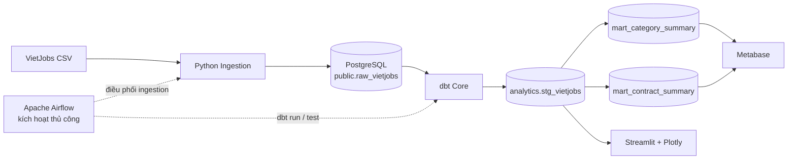
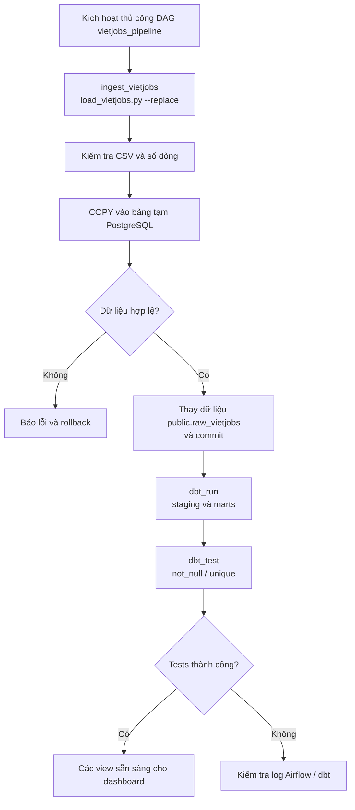
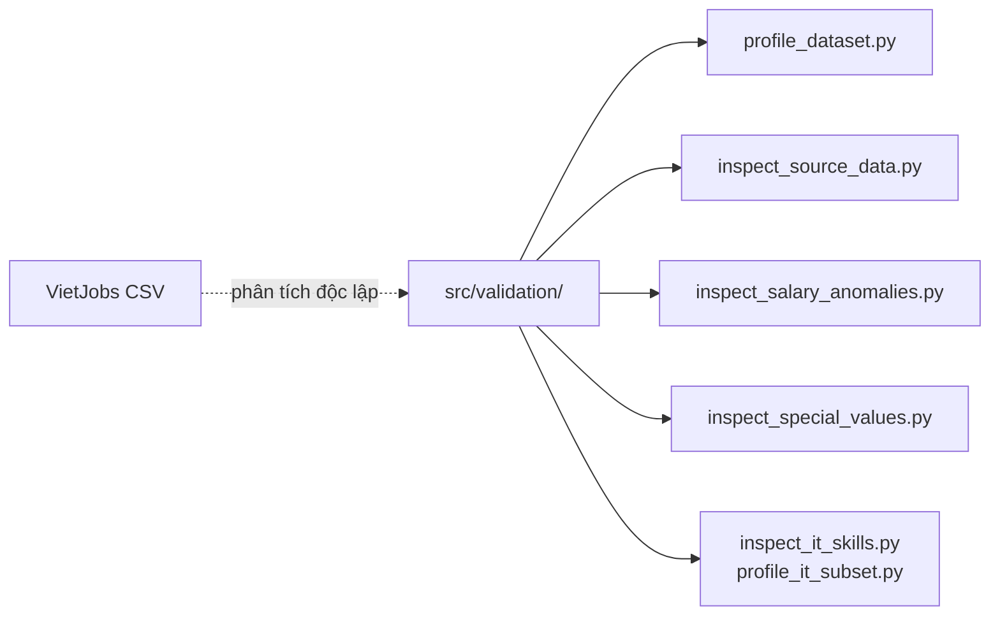
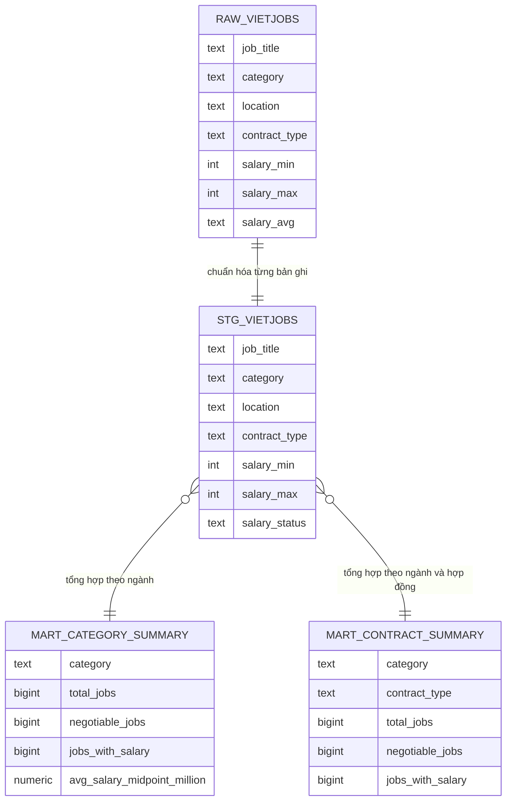

# Vietnam Job Market Intelligence

**Dự án Data Engineering end-to-end** phân tích dữ liệu tuyển dụng Việt Nam bằng **Python, PostgreSQL, dbt, Apache Airflow, Docker Compose, Streamlit và Metabase**.

> **Phạm vi:** Đây là pipeline xử lý **dữ liệu lịch sử từ tệp CSV**, không phải hệ thống cập nhật tin tuyển dụng theo thời gian thực. Airflow được kích hoạt thủ công (`schedule=None`).

## 1. Tổng quan

Dữ liệu VietJobs đã được kiểm tra tại môi trường phát triển gồm **48.092 bản ghi, 18 cột và 16 nhóm ngành nghề**. Hệ thống thực hiện kiểm tra dữ liệu nguồn, nạp vào PostgreSQL, chuẩn hóa và tổng hợp bằng dbt, kiểm thử chất lượng dữ liệu và hiển thị dashboard.

**Các câu hỏi phân tích:** Ngành nghề và địa điểm nào xuất hiện nhiều? Bao nhiêu tin công khai lương hoặc để mức thỏa thuận? Phân bố khoảng lương, loại hợp đồng và kỹ năng chuyên môn ra sao? Trường dữ liệu nào thiếu thông tin?

Nguồn: [VietJobs trên Hugging Face](https://huggingface.co/datasets/dinhieufam/VietJobs) · [Dự án gốc](https://github.com/VinNLP/VietJobs). Tệp CSV không được đưa lên GitHub; cần kiểm tra điều kiện sử dụng trước khi phân phối lại.

## 2. Kiến trúc và các luồng xử lý

Các sơ đồ dưới đây được **tách từ sơ đồ tổng hợp ban đầu** thành ba góc nhìn để dễ đọc và trình bày khi phỏng vấn. Mũi tên nét liền biểu diễn luồng dữ liệu; nét đứt biểu diễn điều phối hoặc công cụ kiểm tra hỗ trợ.

### 2.1. System Architecture — Kiến trúc hệ thống



- **Python Ingestion:** kiểm tra cấu trúc CSV, tải dữ liệu vào bảng tạm và nạp vào bảng raw theo transaction.
- **PostgreSQL:** lưu dữ liệu nguồn và các view phân tích.
- **dbt:** chuẩn hóa dữ liệu, xác định trạng thái lương và tạo hai bảng tổng hợp dạng view.
- **Airflow:** điều phối ba task tuần tự; không chạy lịch định kỳ.
- **Streamlit:** đọc staging view để phân tích; **Metabase:** hỗ trợ khai thác các mart.

### 2.2. Data Pipeline Flow — Luồng thực thi



**Lưu ý:** Nếu dbt thất bại sau khi ingestion đã commit, PostgreSQL **không tự động hoàn tác** lần nạp dữ liệu raw đó.

### 2.3. Source Profiling — Các công cụ kiểm tra hỗ trợ

Sơ đồ gốc còn có các script kiểm tra dữ liệu. Chúng **không phải các task của DAG Airflow**, mà là những công cụ chạy riêng khi cần kiểm tra nguồn.



### 2.4. ERD — Mô hình dữ liệu phân tích



Đây là **ERD logic / data lineage**, không phải sơ đồ khóa ngoại: `raw_vietjobs` là bảng vật lý, còn staging và marts là các **dbt view**. Sơ đồ chỉ hiển thị các trường tiêu biểu; bảng raw thực tế có 18 cột. [Xem giải thích chi tiết](docs/architecture.md).

## 3. Công nghệ sử dụng

| Thành phần | Công nghệ | Vai trò |
| --- | --- | --- |
| Nạp dữ liệu | Python, psycopg, PostgreSQL COPY | Kiểm tra và tải CSV |
| Lưu trữ | PostgreSQL 16 | Bảng raw và các view |
| Chuyển đổi | dbt Core, dbt-postgres | Staging, marts, data tests |
| Điều phối | Apache Airflow 2.10.5 | DAG `vietjobs_pipeline` |
| Dashboard | Streamlit, pandas, Plotly | Phân tích tương tác |
| BI bổ sung | Metabase | Truy vấn các mart |
| Môi trường | Docker Compose | PostgreSQL, Metabase, Airflow |

## 4. Mô hình dữ liệu và quy tắc nghiệp vụ

| Bảng / View | Mức chi tiết | Nội dung |
| --- | --- | --- |
| `public.raw_vietjobs` | Mỗi bản ghi CSV | 18 cột dữ liệu gốc |
| `analytics.stg_vietjobs` | Mỗi bản ghi raw | Chuẩn hóa chuỗi và `salary_status` |
| `analytics.mart_category_summary` | Theo ngành | Số tin, địa điểm, trạng thái và mức lương |
| `analytics.mart_contract_summary` | Theo ngành và hợp đồng | Số tin và trạng thái lương |

Trạng thái lương do dbt tính gồm: `negotiable` (0/0 và `salary_avg = 'Thoả thuận'`), `unavailable` (0/0 nhưng không phải thỏa thuận), `invalid_range` (mức tối đa thấp hơn tối thiểu dương), và `provided` (các trường hợp còn lại).

**Giới hạn phân tích:** Giá trị thiếu đôi khi có nghĩa là *không yêu cầu*, không nhất thiết là lỗi. Dashboard mới dùng nhãn địa điểm từ nguồn, chưa chuẩn hóa địa giới hành chính. Cần xác nhận đơn vị lương từ nguồn trước khi diễn giải kết quả. Dữ liệu không đủ cơ sở để kết luận xu hướng tuyển dụng theo thời gian.

## 5. Cài đặt và chạy trên Windows

### Yêu cầu

- Git, Python 3.11, Docker Desktop và Docker Compose.
- Tải VietJobs CSV từ nguồn và lưu vào `data/raw/external/VietJobs.csv`.

### Bước 1 — Tải dự án và cấu hình

```powershell
git clone https://github.com/VuHuuThinh05/Vietnam-Job-Market-Intelligence.git
cd Vietnam-Job-Market-Intelligence
Copy-Item .env.example .env
New-Item -ItemType Directory -Force data/raw/external
```

Sửa `.env` để `POSTGRES_PASSWORD` và `DB_PASSWORD` khớp với mật khẩu PostgreSQL thực tế. Không commit tệp này. Với volume đã có dữ liệu, thay `POSTGRES_PASSWORD` trong `.env` **không tự đổi mật khẩu tài khoản hiện tại**.

### Bước 2 — Khởi động PostgreSQL và Metabase

```powershell
docker compose config --quiet
docker compose up -d
docker compose ps
```

Với database mới, tạo bảng raw một lần:

```powershell
Get-Content .\sql\init_raw_vietjobs.sql | docker exec -i vietjobs-postgres psql -U vietjobs -d vietjobs
```

Nếu đổi tên database/user trong `.env`, sửa lại lệnh cho phù hợp.

### Bước 3 — Cài Python và biến môi trường

```powershell
python -m venv .venv
.\.venv\Scripts\Activate.ps1
python -m pip install -r requirements.txt

# Nạp các cặp KEY=VALUE từ .env vào phiên PowerShell hiện tại
Get-Content .env | ForEach-Object {
  if ($_ -match '^\s*([^#=\s]+)=(.*)$') {
    [Environment]::SetEnvironmentVariable($matches[1], $matches[2], 'Process')
  }
}
```

Python/Streamlit chạy trên máy host **không tự đọc `.env`**; vì vậy cần xuất biến môi trường trước khi chạy.

### Bước 4 — Cấu hình và chạy dbt

Tạo `profiles.yml` tại thư mục gốc (đã được Git bỏ qua):

```yaml
vietjobs_dbt:
  target: dev
  outputs:
    dev:
      type: postgres
      host: localhost
      port: 5432
      user: "{{ env_var('DB_USER') }}"
      password: "{{ env_var('DB_PASSWORD') }}"
      dbname: "{{ env_var('DB_NAME') }}"
      schema: analytics
      threads: 4
```

```powershell
python .\src\ingestion\load_vietjobs.py
dbt debug --project-dir .\vietjobs_dbt --profiles-dir .
dbt run --project-dir .\vietjobs_dbt --profiles-dir .
dbt test --project-dir .\vietjobs_dbt --profiles-dir .
```

Nếu cần nạp lại dữ liệu, dùng `python .\src\ingestion\load_vietjobs.py --replace`.

### Bước 5 — Mở dashboard

```powershell
streamlit run .\dashboards\app.py
```

Dashboard rút gọn gồm bốn tab: **Overview, Salary, Skills & contracts, Data quality**, kèm bộ lọc và tra cứu bản ghi. Metabase chạy tại `http://localhost:3000`; từ container Metabase, host PostgreSQL là `postgres` trong cùng Docker Compose network.

### Bước 6 — Chạy toàn bộ pipeline qua Airflow (tùy chọn)

```powershell
docker compose -f .\airflow-docker-compose.yml up -d --build
```

Mở `http://localhost:8080`, tìm DAG `vietjobs_pipeline`, bỏ trạng thái tạm dừng nếu cần rồi **Trigger DAG**. Pipeline chạy `ingest_vietjobs → dbt_run → dbt_test`. Cần có `.env`, `profiles.yml` và CSV ở vị trí quy định. Cấu hình hiện tại dùng `host.docker.internal` phù hợp với Docker Desktop trên Windows.

## 6. Cấu trúc thư mục

```text
airflow/
  Dockerfile
  dags/vietjobs_pipeline.py
dashboards/
  app.py
  db.py
docs/
  architecture.md
  source_audit.md
sql/
  init_raw_vietjobs.sql
src/
  ingestion/load_vietjobs.py
  validation/
vietjobs_dbt/
  models/staging/stg_vietjobs.sql
  models/staging/schema.yml
  models/marts/mart_category_summary.sql
  models/marts/mart_contract_summary.sql
docker-compose.yml
airflow-docker-compose.yml
requirements.txt
.env.example
README.md
```

## 7. Kiểm thử và tình trạng dự án

- **Ingestion:** kiểm tra header CSV, số cột, số bản ghi và dữ liệu số; thay dữ liệu raw trong transaction.
- **dbt:** có kiểm thử `not_null` và `unique`; trước đây đã ghi nhận **7 bài kiểm thử thành công** tại máy phát triển.
- **Airflow:** DAG gồm ba task nối tiếp; trước đây đã chạy thành công khi kích hoạt thủ công.
- **Dashboard:** đã được rút gọn mã nguồn; **cần kiểm tra lại trực tiếp trên dữ liệu PostgreSQL trước khi gộp nhánh**.

## 8. Giới hạn và hướng cải thiện

Dự án xử lý batch trên dữ liệu tĩnh, chưa có nguồn cập nhật định kỳ hay CI. Có thể bổ sung kiểm thử Python tự động, ảnh minh chứng từ Streamlit/Airflow/dbt và xác minh khả năng chạy trên một máy mới. Quyền phân phối lại dataset cần được kiểm tra độc lập với mã nguồn.
