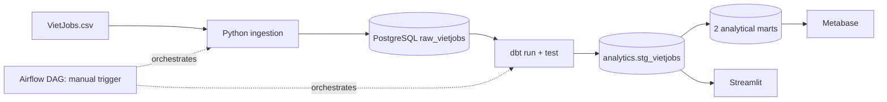

# Vietnam Job Market Intelligence

A local, end-to-end **batch data engineering portfolio project** built with **Python, PostgreSQL, dbt, Apache Airflow, Docker Compose, Streamlit, and Metabase**.

> **Scope:** Historical VietJobs dataset; this project does **not** fetch current vacancies. Airflow runs on demand (`schedule=None`), not on a recurring schedule.

## Overview

The source CSV contains **48,092 job records, 18 fields, and 16 occupational categories** in the locally profiled dataset. This project validates and loads the raw CSV, transforms it into analytical views, executes data-quality checks, and visualizes useful distributions.

**Questions addressed:** Which categories and location labels occur most often? How many jobs provide salary ranges versus negotiable salaries? How do salary midpoints differ across categories? Which technical skills and contracts are most common? Where is source data incomplete?

Source: [VietJobs dataset](https://huggingface.co/datasets/dinhieufam/VietJobs) and [original project](https://github.com/VinNLP/VietJobs). The large CSV is deliberately excluded from Git. Verify its usage conditions before redistribution.

## System architecture

[View complete system architecture, processing flow and logical ERD](docs/architecture.md).



## Stack and components

| Layer | Implementation |
| --- | --- |
| Ingestion | `src/ingestion/load_vietjobs.py`; psycopg and PostgreSQL COPY |
| Raw storage | PostgreSQL 16; `public.raw_vietjobs` |
| Transformation | dbt Core + dbt-postgres; views in `analytics` |
| Orchestration | Airflow 2.10.5; `vietjobs_pipeline` |
| Dashboard | Streamlit, pandas, Plotly |
| Optional BI | Metabase |
| Local services | Docker Compose |

The DAG executes **`ingest_vietjobs → dbt_run → dbt_test`**, with retry configuration and `schedule=None`. Previously observed local runs completed successfully; the GitHub repository itself is not evidence of a fresh execution after checkout.

## Data model

| Model | Grain | Responsibility |
| --- | --- | --- |
| `public.raw_vietjobs` | Original source record | 18 source columns |
| `analytics.stg_vietjobs` | One row per raw record | Text normalization; salary classification |
| `analytics.mart_category_summary` | Category | Job counts and salary availability/statistics |
| `analytics.mart_contract_summary` | Category + contract type | Job and salary-availability counts |

`salary_status` is derived in dbt: `negotiable` for zero/zero salary bounds with `salary_avg = 'Thoả thuận'`; `unavailable` for remaining zero/zero bounds; `invalid_range` for positive salary minimum greater than the maximum; and `provided` for other cases.

**Data caveats:** Missing fields can mean "not required" and are not necessarily errors. Some salary bounds are inconsistent; the dashboard excludes inverted ranges from midpoint calculations. Location labels are unstandardized in the compact dashboard. Salary units should be verified against source documentation before using figures in comparisons. No reliable per-record posting timeline is available.

## Quick start (Windows PowerShell)

### Prerequisites

Python 3.11, Git, Docker Desktop/Compose, and the VietJobs source CSV. Commands below assume the repository root as the current working directory.

### 1. Clone, configure and prepare the source file

```powershell
git clone https://github.com/VuHuuThinh05/Vietnam-Job-Market-Intelligence.git
cd Vietnam-Job-Market-Intelligence
Copy-Item .env.example .env
New-Item -ItemType Directory -Force data/raw/external
```

Edit `.env` with a **local development password** and ensure `POSTGRES_PASSWORD` matches `DB_PASSWORD`. Put the downloaded file at:

```text
data/raw/external/VietJobs.csv
```

The source CSV is not committed. PostgreSQL only applies `POSTGRES_PASSWORD` when initially creating a fresh data volume; changing this value later does not reset the password of an existing user.

### 2. Start PostgreSQL and Metabase

```powershell
docker compose config --quiet
docker compose up -d
docker compose ps
```

On a new database, create the raw table once before ingestion:

```powershell
Get-Content .\sql\init_raw_vietjobs.sql | docker exec -i vietjobs-postgres psql -U vietjobs -d vietjobs
```

If you change `POSTGRES_USER` or `POSTGRES_DB`, adjust the command accordingly.

### 3. Install dependencies and expose local environment variables

```powershell
python -m venv .venv
.\.venv\Scripts\Activate.ps1
python -m pip install -r requirements.txt

# Populate PowerShell environment variables from local .env (simple KEY=VALUE lines).
Get-Content .env | ForEach-Object {
  if ($_ -match '^\s*([^#=\s]+)=(.*)$') {
    [Environment]::SetEnvironmentVariable($matches[1], $matches[2], 'Process')
  }
}
```

**Important:** `.env` is a local Docker Compose configuration file; running Python or Streamlit from PowerShell does not automatically load it unless variables are exported as above.

### 4. Configure dbt

Create a local, Git-ignored `profiles.yml` at the project root:

```yaml
vietjobs_dbt:
  target: dev
  outputs:
    dev:
      type: postgres
      host: localhost
      port: 5432
      user: "{{ env_var('DB_USER') }}"
      password: "{{ env_var('DB_PASSWORD') }}"
      dbname: "{{ env_var('DB_NAME') }}"
      schema: analytics
      threads: 4
```

Run ingestion and transformations:

```powershell
python .\src\ingestion\load_vietjobs.py
dbt debug --project-dir .\vietjobs_dbt --profiles-dir .
dbt run --project-dir .\vietjobs_dbt --profiles-dir .
dbt test --project-dir .\vietjobs_dbt --profiles-dir .
```

For a later explicit refresh, use `python .\src\ingestion\load_vietjobs.py --replace`. Its database transaction protects against partial raw-table replacement.

### 5. Launch the compact Streamlit dashboard

```powershell
streamlit run .\dashboards\app.py
```

The dashboard offers **Overview, Salary, Skills & contracts, and Data quality** tabs, plus record search. It reads `analytics.stg_vietjobs` and uses `DB_PASSWORD` from the running shell.

Metabase is available locally at `http://localhost:3000`. To connect from the Metabase container, configure PostgreSQL host `postgres`, port `5432`, and the credentials from your environment, assuming both services share the default Compose network.

### Optional: Run the entire batch with Airflow

```powershell
docker compose -f .\airflow-docker-compose.yml up -d --build
```

Open `http://localhost:8080`, locate `vietjobs_pipeline`, enable/unpause it if needed, and **trigger it manually**. The Airflow DAG runs ingestion with `--replace`, followed by `dbt run` and `dbt test`. Both `.env` and `profiles.yml` must be present in the mounted project folder. The Airflow setup uses `host.docker.internal` and targets Windows Docker Desktop; additional configuration may be needed on other systems.

## Repository layout

```text
airflow/
  dags/vietjobs_pipeline.py
  Dockerfile
dashboards/
  app.py
  db.py
docs/
  architecture.md
  source_audit.md
sql/
  init_raw_vietjobs.sql
src/
  ingestion/load_vietjobs.py
  validation/
vietjobs_dbt/
  models/staging/stg_vietjobs.sql
  models/staging/schema.yml
  models/marts/mart_category_summary.sql
  models/marts/mart_contract_summary.sql
docker-compose.yml
airflow-docker-compose.yml
requirements.txt
.env.example
README.md
```

## Testing and verification

- Ingestion verifies CSV schema, record counts, and numeric salary bounds, and uses a transaction.
- dbt includes `not_null` and `unique` data tests for selected staging/mart fields; **7 tests** were previously reported as passing in the local environment.
- Airflow includes three connected tasks. A previous manual run was reported successful, but CI-based automation, scheduled ingestion, and independent fresh-clone verification are **not** claimed.
- Streamlit dashboard should be reviewed against the source data after each dashboard change.

## Remaining limitations and improvements

This is a portfolio-scale local batch workflow. The source is historical and static; there is no recurring API ingestion or live market coverage. Missing values and categorical skill strings require domain-specific interpretation. The dashboard uses the raw source location labels rather than geocoded regions. An automated test suite for Python ingestion/dashboard helpers and reproducible screenshot evidence would improve the handoff.

The source dataset's redistribution rights should be confirmed independently of this code repository.
