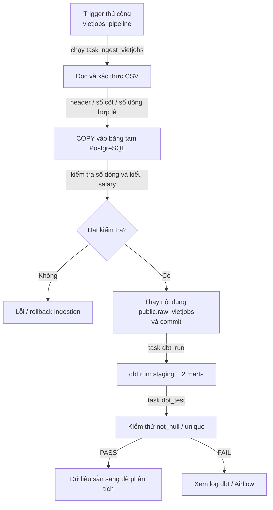
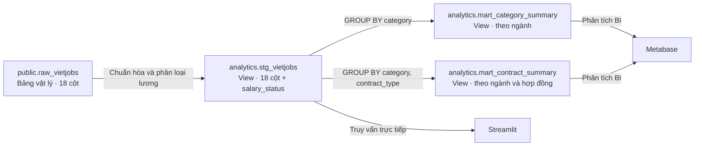

# Kiến trúc và luồng xử lý — Vietnam Job Market Intelligence

Tài liệu này mô tả **các thành phần đã được triển khai trong repository**. Dự án xử lý dữ liệu CSV lịch sử theo batch; Airflow hiện chạy theo yêu cầu (`schedule=None`), không có lịch thu thập dữ liệu tự động.

## 1. Kiến trúc hệ thống

Sơ đồ tổng quan và ảnh minh chứng được trình bày ở [README](../README.md). Hệ thống gồm:

| Thành phần | Mã nguồn / dịch vụ | Nhiệm vụ |
| --- | --- | --- |
| Nguồn | `data/raw/external/VietJobs.csv` (không commit) | CSV gồm 18 cột |
| Ingestion | `src/ingestion/load_vietjobs.py` | Xác thực CSV, COPY qua bảng tạm, ghi vào raw trong transaction |
| Lưu trữ | PostgreSQL 16 | Bảng `public.raw_vietjobs` và các view `analytics` |
| Chuyển đổi | `vietjobs_dbt/` | Staging + hai marts dạng view |
| Điều phối | `airflow/dags/vietjobs_pipeline.py` | Thực thi ba task tuần tự |
| Phân tích | `dashboards/app.py`, Metabase | Streamlit đọc staging; Metabase có thể truy vấn các mart |

`docker-compose.yml` khởi tạo PostgreSQL và Metabase; `airflow-docker-compose.yml` chạy Airflow trong môi trường Docker Desktop trên Windows. Streamlit được chạy trực tiếp bằng Python trên máy host.

## 2. Pipeline Flow

**Giới hạn transaction:** lỗi trong ingestion có thể rollback các thay đổi của lần nạp đó; lỗi dbt sau khi ingestion đã commit **không** rollback bảng raw.

## 3. Data lineage và mô hình phân tích

Đây là **quan hệ biến đổi dữ liệu (lineage)**, không phải quan hệ khóa ngoại. Mã nguồn không khai báo primary key / foreign key giữa raw, staging và marts; do đó không gán ký hiệu PK/FK giả định.

### Các model đã triển khai

| Model | Chi tiết |
| --- | --- |
| `stg_vietjobs.sql` | Giữ 18 trường nguồn, chuẩn hóa chuỗi, thêm `salary_status` |
| `mart_category_summary.sql` | `total_jobs`, `total_locations`, phân loại lương, trung bình midpoint theo ngành |
| `mart_contract_summary.sql` | `total_jobs`, `negotiable_jobs`, `jobs_with_salary` theo ngành và loại hợp đồng |

## 4. Script kiểm tra nguồn

Các script trong `src/validation/` phục vụ khảo sát dữ liệu và kiểm tra bất thường **độc lập với DAG Airflow**. Chúng không mặc nhiên chạy trong ba task của `vietjobs_pipeline`. Phương pháp và các vấn đề dữ liệu đã được ghi ở [source_audit.md](source_audit.md).

## 5. Quy tắc và giới hạn

- `negotiable`: `salary_min = salary_max = 0` và `salary_avg = 'Thoả thuận'`.
- `unavailable`: các bản ghi min/max cùng bằng 0 nhưng không ở trạng thái thỏa thuận.
- `invalid_range`: `salary_min > 0` và `salary_max < salary_min`.
- `provided`: những trường hợp còn lại theo CASE hiện tại của staging model.

**Lưu ý:** `provided` là tên nhãn do SQL hiện tại gán, không bảo đảm mọi bản ghi mang nhãn này đều có một khoảng lương dương và hợp lệ. Báo cáo/dashboard phải kiểm tra thêm điều kiện số khi tính thống kê lương. Đây là giới hạn hiện tại cần nêu đúng, không tự nhận là đã sửa SQL.
