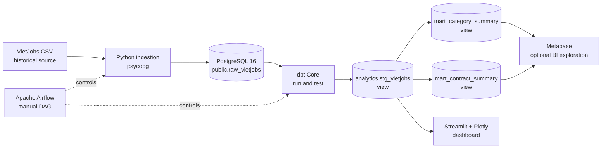
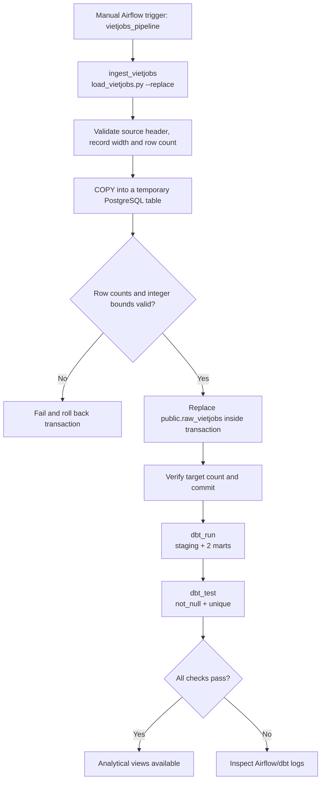
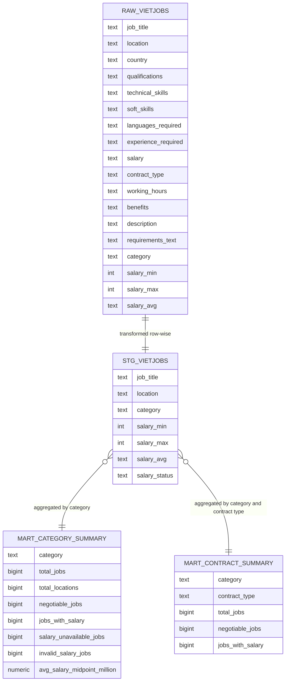

# System Architecture, Pipeline Flow and Logical ERD

The implemented project is a **local batch analytics pipeline** based on a historical VietJobs CSV. Airflow uses `schedule=None` (manual execution, not scheduled ingestion).

## 1. System architecture

The database and Metabase run under `docker-compose.yml`. Airflow runs under `airflow-docker-compose.yml`, reaching the host-published PostgreSQL port with `host.docker.internal` on Windows Docker Desktop. Streamlit runs from the host Python environment.

## 2. Processing/data flow

The ingestion transaction can roll back its own failed load, but a downstream dbt failure **does not undo** an already committed raw load. The raw table must exist before the first ingestion; see `sql/init_raw_vietjobs.sql`.

## 3. Logical ERD / analytical lineage

The application is not a normalized transactional system. There is one **raw physical table**, a staging **dbt view**, and two aggregate **dbt views**. Relations below express derivation and grouping only—not declared foreign keys or enforced relationships.

The staging view retains all 18 source columns and adds `salary_status`; only selected fields are shown in the ERD for readability. Grouped mart keys are analytical groupings, not SQL foreign keys.
